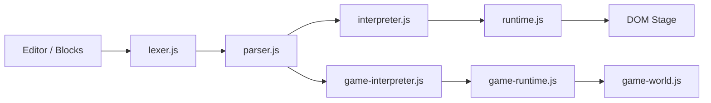

# KiddyFun Architecture

## Pipeline



## Modes

| Mode | Detection | Runtime |
|------|-----------|---------|
| Story | No `game "..."` | `SpeakInterpreter` + `SpeakRuntime` |
| Game | `game "..."` or game-only AST | `GameInterpreter` + `KiddyGameRuntime` |

## Key modules

| File | Role |
|------|------|
| `experience-mode.js` | Kid / Creator / Studio UI |
| `smart-editor.js` | Autocomplete, gutter, lint |
| `blocks-mode.js` | Visual block palette |
| `storage.js` | localStorage + cloud hooks |
| `supabase-sync.js` | Cloud merge |
| `publish.js` | Share URLs `?p=` / `?z=` |
| `game-combat.js` | G8 health, bullets, chase |
| `game-maps.js` | Built-in map layouts |

## Experience layers

Features are gated with `data-creator-only`, `data-studio-only`, or `KiddyExperience.isCreator()`.

## Tests

```bash
npm test
npm run test:examples
```

GitHub Actions: `.github/workflows/test.yml`
